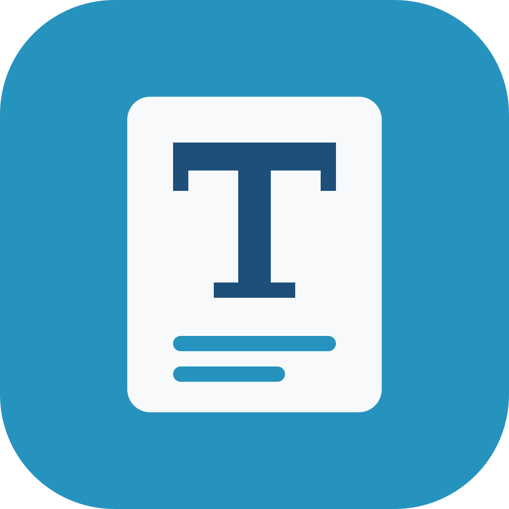

<p align="center">
  
</p>

<h1 align="center">Typisch</h1>

<p align="center">
  A fast, native <a href="https://typst.app">Typst</a> editor for macOS.<br>
  Write your document and watch it take shape as you type.
</p>

---

- **Live preview** with clickable links
- **Autocompletion** as in the Typst web app – functions, parameters, symbols, labels and snippets while you type, or with Ctrl+Space
- **PDF export**, ready to print or share
- **Built-in templates** for letters, CVs, reports and more
- **Symbol palette** – search the full Typst symbol table or just draw the symbol
- **Zotero sync** – keep a BibLaTeX bibliography in your project up to date with your Zotero library, a collection or a group
- **Git Sync** – pull and push your project with GitHub, GitLab or any Git server
- **Fully native** – written in Rust, no browser, no account

## Get started

Requires Rust 1.95 or newer (`rustup update stable`).

```sh
cargo run --release -- [folder-or-file]
```

To build the Mac app, run `sh macos/make-app.sh` and drag `dist/Typisch.app` into your Applications folder. Built this way the app is signed for your own Mac; the script's first lines describe how to make a universal, Developer ID-signed and notarised app for other Macs.

On Linux, [linux/typisch.desktop](linux/typisch.desktop) is a launcher for the application menu: put the `typisch` program on your `PATH`, copy the file to `~/.local/share/applications/` and an icon named `typisch` (`typisch --export-icon typisch.png`) to `~/.local/share/icons/`.

## Git Sync

Keep a project in a Git repository and sync it with two buttons, much like Git Sync in the Typst web app.

- **Linking** – in the *Git* tab of the settings, choose *Mit Repository verbinden …* and enter the address of an existing repository and a branch. A folder you already cloned with Git is linked automatically. To start from a repository, use *Aus Git-Repository klonen …* on the start screen.
- **Pull** (arrow down, top right) brings in what others pushed. Its badge shows how many new commits are waiting; Typisch looks for them every few minutes. Your own edits stay as they are.
- **Push** (arrow up) commits the changes in the project folder with a message and your name and e-mail address, then uploads them. Its badge shows when you last pushed. If someone pushed first, Typisch asks you to pull first – it never force-pushes.
- **Conflicts** – when both sides changed the same text file, both versions' lines are kept, so check the file afterwards. Only for images and other non-text files, for files deleted on one side and edited on the other, and for files created on both sides, Typisch asks which version to keep.
- **Credentials** – Typisch uses your Git setup: the macOS keychain or your SSH key. For HTTPS addresses it asks for a username and access token when needed (on GitHub and GitLab, create a token instead of using your password); Git's keychain helper then remembers it.

Git Sync needs `git` 2.28 or newer. On macOS it comes with the Xcode Command Line Tools: `xcode-select --install`.

<details>
<summary>Command-line options</summary>

| Option | Purpose |
| --- | --- |
| `[folder-or-file]` | Open a project folder or `.typ` file |
| `--export-icon <icon.png> [size]` | Write the app icon as a PNG and exit |
| `--screenshot <image.png>` | Render the window to an image (for testing) |

</details>

## Continuous integration

[CI](.github/workflows/ci.yml) checks the formatting (rustfmt), lints (clippy) and tests every pull request and every push to `master` on macOS and Linux with the newest stable Rust and exactly the crate versions in `Cargo.lock`, checks that the oldest supported Rust (`rust-version` in `Cargo.toml`) still builds it, and checks the dependencies for security advisories ([deny.toml](deny.toml)). Every Monday it repeats this with all crates moved to their newest compatible versions. [Dependabot](.github/dependabot.yml) opens weekly pull requests for new crate and GitHub Actions releases.
